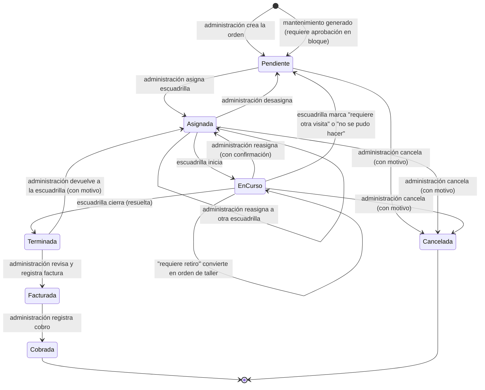

# Máquina de estados de la orden de trabajo

Los siete estados los pidió el cliente: **Pendiente, Asignada, En curso, Terminada, Facturada, Cobrada, Cancelada**.

> Las transiciones de esta página se validaron con negocio el 2026-10-26 (refinamiento de E04-01). La reasignación se sumó el 2026-10-27 (refinamiento de E04-04). Lo que sigue abierto figura en [decisiones pendientes](../domain/decisiones-pendientes.md).

## Diagrama

`EnCurso` es el estado `En curso`. Mermaid no admite espacios en los identificadores.

## Reglas

| # | Regla |
|---|---|
| R1 | Solo administración crea, asigna, revisa, factura, cobra y cancela. Solo la escuadrilla asignada (su usuario, rol `technician`) inicia y cierra. |
| R2 | Cada cambio de estado inserta un `work_order_event` con actor y fecha. Las fechas de la orden salen de ahí. |
| R3 | Cancelar exige motivo y solo es posible antes de `Terminada`. |
| R4 | `Facturada` exige número de factura. `Cobrada` solo desde `Facturada`. |
| R5 | `Cobrada` y `Cancelada` son finales. Una corrección es una nueva orden o un ajuste con auditoría, no una reapertura. |
| R6 | Una orden con `requires_approval = true` no se puede asignar hasta que administración apruebe el lote. |
| R7 | Cada orden (o etapa, en taller) tiene una sola escuadrilla responsable (D-013). Se asigna con fecha prevista, sin hora. Quiénes fueron se registra al cerrar. |
| R8 | Devolver a la escuadrilla una orden `Terminada` exige motivo y la deja `Asignada` a la misma escuadrilla. |
| R9 | Reasignar cierra la asignación vigente y abre la nueva en una transacción. Una orden `En curso` reasignada queda `Asignada` para la nueva escuadrilla, que la tiene que iniciar. Desasignar solo es posible desde `Asignada` (E04-04). |

## Órdenes de taller (retiro, taller y devolución)

Una orden `workshop` tiene tres etapas con avance propio. El estado de la orden se calcula así:

| Situación de las etapas | Estado de la orden |
|---|---|
| Ninguna etapa asignada | Pendiente |
| Alguna etapa asignada, ninguna iniciada | Asignada |
| Alguna etapa iniciada o terminada, la devolución sin terminar | En curso |
| Devolución terminada | Terminada |

Retiro y devolución exigen firma del cliente (nombre y DNI). La orden se factura una sola vez, al quedar `Terminada`.

## Cierre de la escuadrilla y resultados

| Resultado elegido | Efecto |
|---|---|
| Resuelta | La orden pasa a `Terminada` |
| Requiere retiro | La misma orden pasa a `workshop`, se crean las etapas y sigue `En curso` |
| Requiere otra visita | Vuelve a `Pendiente` sin escuadrilla ni fecha, para reprogramarla (se puede asignar a otra), conservando lo registrado |
| No se pudo hacer (con motivo) | Igual que "requiere otra visita": vuelve a `Pendiente` sin escuadrilla ni fecha, con el motivo visible para la oficina. Sin estado "No realizada" (E05-08) |

## Puntos sin resolver

- **Revisión**: la propuesta técnica muestra "Revisión" como paso entre Terminada y Facturada, pero no es uno de los siete estados del cliente. Se modela como una acción de administración sobre `Terminada` (aprobar o devolver), no como estado. Ver `D-005`.
- **Aprobación en bloque** de mantenimiento: se modela con el campo `requires_approval`, no con un estado extra. Ver `D-005`.
