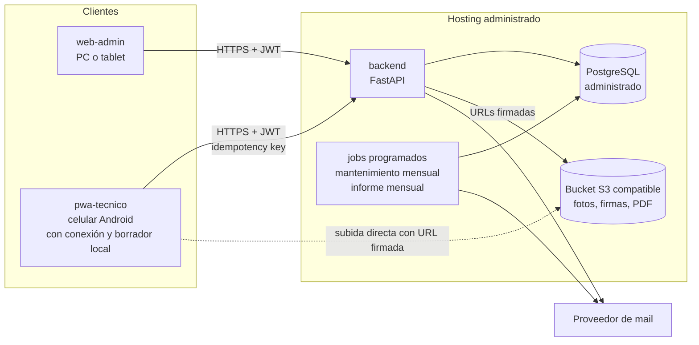

# Visión general de la arquitectura

## Contexto

El sistema reemplaza a Persat y a las planillas dispersas de una empresa de servicios de refrigeración (50 a 200 clientes, 200 a 1.000 equipos, 4 a 6 técnicos, 2 personas de administración, 150 a 300 órdenes por mes en temporada alta). El volumen es bajo. El riesgo principal es operativo (que no se pierdan datos ni órdenes) y de uso en campo (celular, conectividad irregular), no de rendimiento.

## Diagrama

## Componentes

| Componente | Tecnología | Responsabilidad |
|---|---|---|
| `backend` | Python 3.12, FastAPI, SQLAlchemy 2, Alembic | API REST, reglas de negocio, autorización por rol, jobs |
| `web-admin` | React, TypeScript, Vite | Administración: órdenes, fichas, catálogos, stock, tablero |
| `pwa-tecnico` | React, TypeScript, Vite, service worker | Técnico: órdenes asignadas, cierre, firma, foto, borrador del cierre si se corta la señal |
| Base de datos | PostgreSQL 18 administrado | Fuente de verdad, backups con restauración a un punto en el tiempo |
| Almacenamiento | S3 compatible (Cloudflare R2, Backblaze B2 o S3) | Fotos, firmas y PDF, con URLs firmadas |
| Mail | Proveedor transaccional (a definir, `D-009`) | Informe mensual y comprobantes |

## Principios

1. **La API es la frontera de seguridad.** Lo que el técnico no puede ver no sale de la API (ver [ADR 0006](adr/0006-visibilidad-por-rol-en-la-api.md)).
2. **Modular dentro de un solo despliegue.** Un backend con módulos por dominio (ordenes, catalogos, clientes, stock, mantenimiento, informes), sin microservicios. Si un módulo crece, se separa con el contrato ya definido.
3. **Portable.** Todo corre en Docker. Si el hosting cambia, se mueve sin reescribir (ver [ADR 0004](adr/0004-hosting-paas-postgres-administrado.md)).
4. **Datos con historia.** Estados, precios, stock y asignaciones son tablas de transacción que se agregan, no se pisan (ver [ADR 0005](adr/0005-reglas-de-datos.md)).
5. **Offline como requisito condicional.** La PWA se diseña para soportarlo, y se activa según la respuesta del cliente (ver [ADR 0003](adr/0003-pwa-offline-first-provisional.md)).

## Módulos del backend

| Módulo | Épicas relacionadas |
|---|---|
| `auth` | E01 |
| `catalogs` | E02 |
| `clients`, `equipment` | E03 |
| `orders`, `workshop` | E04, E05, E06 |
| `maintenance` | E07 |
| `stock` | E08 |
| `reports` | E09, E10 |
| `migration` | E11 |
| `audit` | E12 |

## Calidad y operación

- CI en cada PR: lint, tipos, tests con Postgres real, validación de historias.
- Revisión automática de PR con Claude contra las reglas de dominio.
- Staging automático desde `main`, producción por tag con aprobación.
- Observabilidad mínima: logs estructurados sin datos personales, alerta de caída, reporte de errores.
- Backups diarios y prueba de restauración trimestral (historia E00-07).

## Estado de las decisiones

| ADR | Tema | Estado |
|---|---|---|
| [0001](adr/0001-monorepo.md) | Monorepo | Aceptado |
| [0002](adr/0002-backend-fastapi-postgresql.md) | Backend FastAPI y PostgreSQL | Aceptado |
| [0003](adr/0003-pwa-offline-first-provisional.md) | PWA con modo offline | Provisional (falta confirmar conectividad con el cliente) |
| [0004](adr/0004-hosting-paas-postgres-administrado.md) | Hosting PaaS con Postgres administrado | Aceptado, proveedor sin elegir |
| [0005](adr/0005-reglas-de-datos.md) | Reglas de datos | Aceptado |
| [0006](adr/0006-visibilidad-por-rol-en-la-api.md) | Visibilidad por rol en la API | Aceptado |
| [0007](adr/0007-orden-unificada-con-etapas.md) | Orden unificada con etapas | Aceptado |
| [0008](adr/0008-agentes-de-ia-en-el-repositorio.md) | Agentes de IA en el repositorio | Aceptado |
